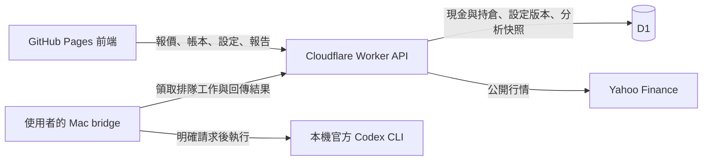

# Northstar 功能架構與 0.2 更新

目前沿用已接受的白／灰／黑／橙設計，主要入口為市場研究、我的資產、研究報告。「機會與風險，一起看清楚。」區塊及「資料連線」頁面已按要求移除；未接通資料或分析端的提示保留在相關操作旁。

## 執行架構

固定前端網址仍為 https://angusqaq.github.io/stock-website/ 。Pages 提供介面，獨立 Worker 提供動態資料，D1 保存帳本與報告。Mac 不在線時仍可保存資產，分析工作等待接收。

原始碼、本機 Worker／D1 與部署套件已實作及驗證。正式 Worker、真實行情、富途官方費率與 Mac 訂閱分析仍未完成連接驗證；不能把本機成功描述為正式平台已接通。詳見 [部署說明](deployment.md)。

## 風險設定

在「我的資產」展開「投資風險設定」，可編輯三組的單股倉位上限與每筆風險上限。市場分析區的「調整限額」會直接開啟這個區域。

- 初始建議是保守 10%／0.5%、平衡 15%／1%、進取 25%／2%。版本 0 表示尚未儲存自己的設定，不代表這些比例已獲使用者定案。
- 比例最多兩位小數，以整數基點儲存：100 基點 = 1%。三組限額須依序相同或遞增，每筆風險不得高於倉位上限。
- 按「儲存風險設定」才寫入 D1。每次寫入比對版本，多個視窗同時修改時，過期版本回傳 409，保留本機草稿供使用者檢視；不自動覆蓋新版本。
- 「恢復建議比例」只改表單，還需按儲存才寫入；「重新載入設定」讀取目前已保存的版本。
- 開始分析時，後端保存該次的 `riskLimits`、`settingsRevision`、資產／行情快照與基準時間。之後改設定，不會改寫舊報告的限額。

倉位計算同時受可用現金、既有集中度、交易費用及止損距離限制。集中度以扣除預計費用後的總資產計算，避免費用使實際倉位略超上限。介面分開顯示股票金額與連費用所需現金；額度不足時不建議新增倉位。舊報告若未保存具體限額，不以現在的設定補算。

## 歷史報告

「研究報告」可依股票與投資期間篩選，每次讀取 20 份，再按「載入更多報告」。後端以建立時間及 ID 排序，時間相同的報告也能穩定分頁。

點選後依該份 ID 讀取完整內容，保留結論、理由、風險、參考價位、當時設定與資料時間；不跳到同股票的另一份最新報告。歷史閱讀不重新呼叫模型，也不按現在的資產重算舊買入建議。需要新建議時，可按「研究這隻股票」回到市場頁，再明確開始分析。

## 分析排隊

同一時間只接受一份排隊或執行中的分析。使用者按分析才建立工作，保存設定、看行情、翻閱報告及刷新頁面都不觸發模型。

尚未領取的工作可在市場頁或報告頁取消。取消與 Mac 領取使用資料庫條件更新，兩者同時發生只會有一方成功；已開始或已完成的工作不接受「取消排隊」。重複取消同一份已取消工作會回傳相同狀態。

為兼容原有狀態約束，資料庫將已取消工作記為 `status=failed` 並設定 `cancelled_at`；前端透過 `cancelledAt` 顯示「已取消」，與真正的分析失敗分開。Mac 只領取 `queued`，不會執行已取消工作。

## 資料與部署契約

| 路徑 | 用途 |
| --- | --- |
| `GET /api/health` | 實際讀取帳本、設定及新欄位；就緒才回報 `storage=true`、`schemaVersion=2` |
| `GET /api/settings/risk` | 讀取三組設定與版本；未儲存時明示版本 0 |
| `POST /api/settings/risk` | 以 `{revision, profiles}` 儲存；衝突回傳 409 |
| `GET /api/analysis/history` | 股票／期間篩選與游標分頁；不觸發模型 |
| `GET /api/analysis/jobs/:id` | 取得該份報告及其保存的限額，不公開機器端領取憑證 |
| `POST /api/analysis/jobs/:id/cancel` | 原子取消仍在排隊的工作 |

`0002_research_workflow.sql` 為新增設定表及取消時間欄位的加法式遷移；保留原有帳本與報告。測試會先建立舊資料再升級，確認金額及歷史工作仍存在。既有 `npm run deploy` 會先套用遠端 migrations 再部署 Worker；不要跳過遷移或清空正式資料庫。

前端請求設有 15 秒逾時與切換取消。帳本輪詢不重疊，寫入後強制重新讀取會取消舊請求，避免過期回應把剛取消的工作重新顯示為排隊。個別讀取失敗不會令其他成功的資料一併消失。

GitHub Pages 未設定 `VITE_API_BASE_URL` 時，不送出 API 請求，資金儲存、設定儲存與模型分析保持停用。正式串接仍需在安全設定提供 Cloudflare 部署權限、套用所需網域，部署真實 API 後把其 origin 設入 GitHub Actions Variable；不更換前端網址，不在聊天或 Git 提供 token。

## 本機驗證邊界

網站測試執行真實 SQLite SQL；瀏覽器另操作獨立的本機 Worker／D1，驗證記帳、儲存後重整、多視窗衝突、36 份歷史紀錄、精確報告與取消排隊。行情由本機瀏覽器攔截器提供明示測試資料，報告為測試庫預置資料，沒有執行真實模型，也沒有將這些內容加入部署資產。

本次驗證庫位於被忽略的 `.local/workflow-validation-v02/state`，與預設本機帳本及任何正式 D1 分開。截圖與結果在 `.impeccable/review/workflow-v02/`，不提交測試資金或報告。
