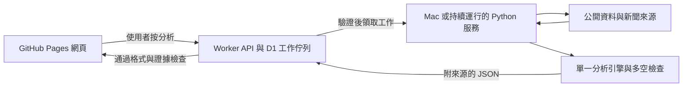

# Northstar 的三套研究工具與教學流程

Northstar 的主要對象是投資新手：先用白話看懂判斷，再追查「事件怎樣影響公司，繼而可能影響股價」。不再收集個人本金／持倉或計算配置金額。網站提供有來源的教學研究，不執行交易。

## 三個專案各自做甚麼

| 專案 | 能提供的能力 | 在 Northstar 的用途 | 實際限制 |
| --- | --- | --- | --- |
| [TradingAgents](https://github.com/tauricresearch/tradingagents) | 基本面、新聞、情緒、技術分析角色，多空辯論與風險檢查，使用 LangGraph 組織模型流程 | 讓同一隻股票同時接受支持、反對和風險檢查；最後整理成簡單結論與反證 | 需要模型及資料供應商。多個角色共識不等於多份獨立證據，也不保證正確 |
| [OpenBB](https://github.com/openbq-org/OpenBB) | Python 資料整合 SDK、REST API 等，統一不同供應商的行情／金融資料介面 | 收集 OHLCV、財報及可用市場資料，保存時間、單位、來源，供圖表和報告核對 | 是資料層；本身不等於投資顧問。部分供應商需要金鑰或授權，開源程式不代表即時數據免費 |
| [Daily Stock Analysis](https://github.com/ZhuLinsen/daily_stock_analysis) | 美股等市場資料擷取、新聞搜尋、技術整理、決策報告與 FastAPI 任務介面 | 參考或逐步接入資料／新聞整理模組，把事件、指標與報告流程串起來 | 網路來源及搜尋金鑰影響可用性。排程與外部推送必須關閉；只在按分析後工作 |

核對的是 `config/research-sources.json` 的固定版本：TradingAgents `9fa1196`、OpenBB `2a392e8`、Daily Stock Analysis `a52c325`。這些是完整 Python 專案，不是放進網頁就會執行的三個提示詞。

## 現在已連接到哪一步

三套原始碼與獨立 Python 環境已安裝在開發環境的忽略目錄，入口見 [research-tools.md](research-tools.md)。**安裝不等於三套引擎已在正式網站共同運行。** 目前實作的 Mac bridge 使用 `scripts/research_data.py` 收集公開資料，再呼叫 Codex CLI，並參照技能與研究提示；尚未直接執行三套完整框架。

GitHub Pages 能顯示公開 TradingView 圖表及互動教學。自動產生並保存 AI 報告，仍需要部署研究 API、設定網址及連接 Mac。未連接時，按「分析」會提供可複製的研究題目，清楚說明須貼到 Codex 執行，結果不會自動回寫網站。沒有以示範報告或假行情冒充真實研究。

TradingAgents 的核對版本支援自己的 ChatGPT 訂閱登入流程；它使用獨立的 `tradingagents login chatgpt`，不能據此推定已共用 Codex 桌面登入、已驗證額度或一定符合使用者的訂閱。未確認前不自動啟用額外付費模型。

## 正式運行的部署分工

- **Pages**：選股、K 線、因果教學、報告、註腳；不保存服務金鑰，也不能執行 Python 引擎。
- **Worker／D1**：佇列、資料快照、結果驗證與歷史紀錄；不是三套大型 Python 框架的執行主機。
- **Mac／Python 服務**：資料擷取與模型推理。建議 OpenBB 作統一資料介面，選用 Daily Stock Analysis 的新聞／資料模組，最後由**一個**主引擎產出報告；現階段保留 Codex CLI。TradingAgents 完整引擎是另行驗證的替代選項，不把三套模型流程逐層套用。
- **憑證**：只在服務環境設定；不加入 Git、不放在前端、不讀取或轉傳使用者的登入檔。部署步驟見 [deployment.md](deployment.md)。

新工作不包含個人資產快照。原有帳本資料、資料庫遷移與舊報告保留，網站已移除資產功能。沒有新增登入或接駁券商。

## 新手看到的報告

1. 股票、五級評級、白話結論；資料不足時不強制評級。
2. 支持與反對理由：甚麼證據支持判斷，甚麼事情會推翻它。
3. 四種研究價位：建議買入、建議賣出、止損、止盈。各有來源依據，缺資料就不畫線；止損不是保證能以該價格成交。
4. 研究 K 線：四種顏色及不同線型，小字放在右側價格軸，避開陰陽燭。公共 TradingView 嵌入圖不能注入這些自訂線，所以價位畫在 Northstar 自有的報告圖。
5. 新聞因果：事件 → 需求／成本／利率 → 盈利／估值 → 可能股價反應，再列反向因素。新聞與升跌同日發生不足以證明因果。
6. 原始財報、技術、資金、高管及 Call／Put 證據預設可展開；每段分析及數字附可點擊來源註腳，報告最後保留來源清單。

圖表顯示週期和研究期間是兩個不同選項：「日K」是每根代表一個交易日，「一個月研究」是觀察未來 30 個曆日。研究圖的 5日K 每五根已載入日K聚合，最後一根可能未滿五日；月K按曆月聚合。公開嵌入圖使用明確 `interval`，不再以回看範圍 `range` 代替週期。

## 資訊品質要求

資料有發布時間、擷取時間、來源、單位及缺漏狀態；不得把刷新頻率當成交易所即時保證。新聞需要核對原文與日期；財報要比較相同期間；技術指標必須由原始 OHLCV 計算。價量代理不稱為真實機構流入，Call／Put 量不直接當成買方方向，高管買賣須核對申報與交易性質。

模型 JSON 經 schema、來源索引、段落註腳、證據分類、日期、評級一致性及資料不足檢查。這些檢查不能證明模型推論一定正確，教學報告仍須呈現不確定性與反證。

## 0.4.2 四因素圖與綜合入場判斷

這是股票分析報告內的內容，沒有恢復已刪除的通用教學面板。開首先保留短結論，再以四個可切換因素解釋「事件／數據 → 傳導 → 公司盈利／估值 → 股價可能反應」，每項列資料日期、量化數值、註腳及反向因素；缺資料時明示未知，不畫假因果、不生成影響分數。

報告提供跳轉連結查看因素圖、K 線與價位及最後的綜合入場判斷。最後明確回答：現在能否考慮入手、應等待甚麼、所選期間可能走勢、甚麼關鍵條件出現才重估入場，以及何時失效／再查核。每項觸發條件可展開核對確認方式與失效條件，附直接來源連結；條件出現仍需重新研究，不自動下單。

新工作契約為 `learning-decision-factors-v2`，新增 `research.drivers` 與 `research.decision`；Mac 提示、JSON schema 及 Worker 必須同步更新。沿用 schemaVersion=2，無新增 D1 migration。舊 `learning-prices-citations-v1` 工作及報告不追補新欄位，畫面說明未保存這些內容。資料不足時不評級、不給入場觸發點；「可考慮現在入手」需買入立場、買入／止損價及確認條件。等待判斷必須列等待事項，日期／來源／重複因素與引用索引由伺服器檢查。

這些是報告格式及顯示功能。正式 AI 服務及 Cursor 連線限制仍依 [cursor-connection.md](cursor-connection.md) 與 [deployment.md](deployment.md)，不以本機測試報告冒充實際研究。
